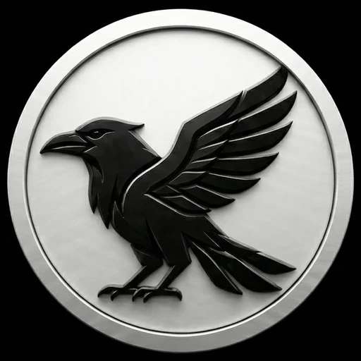
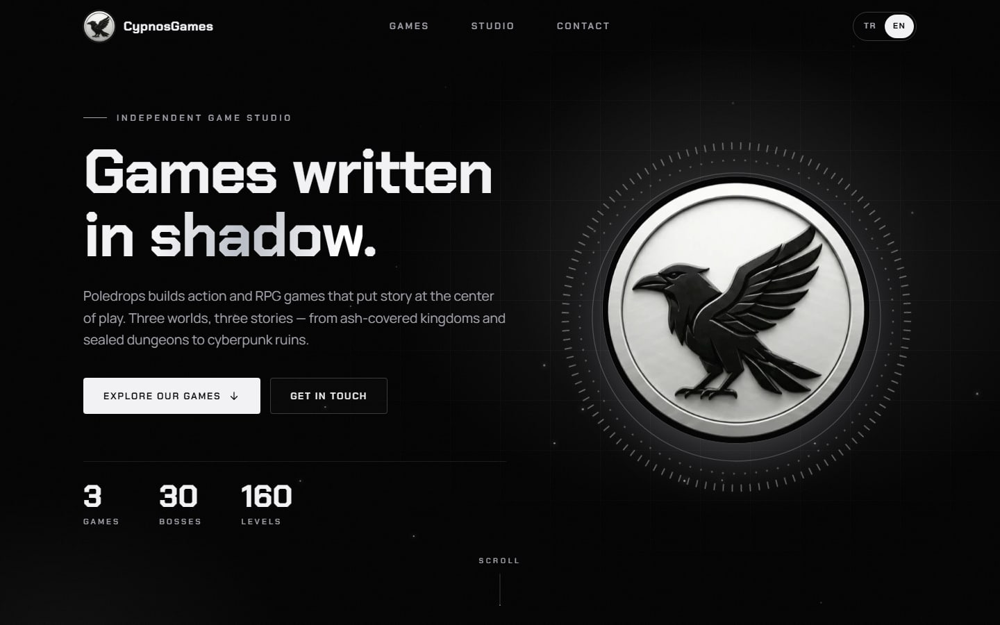
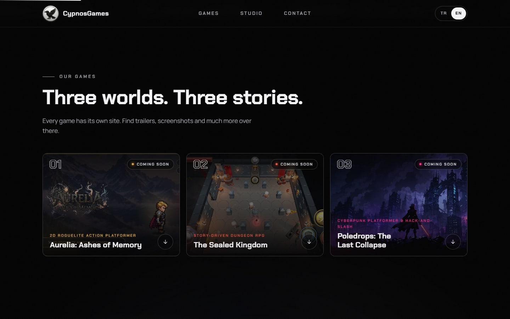
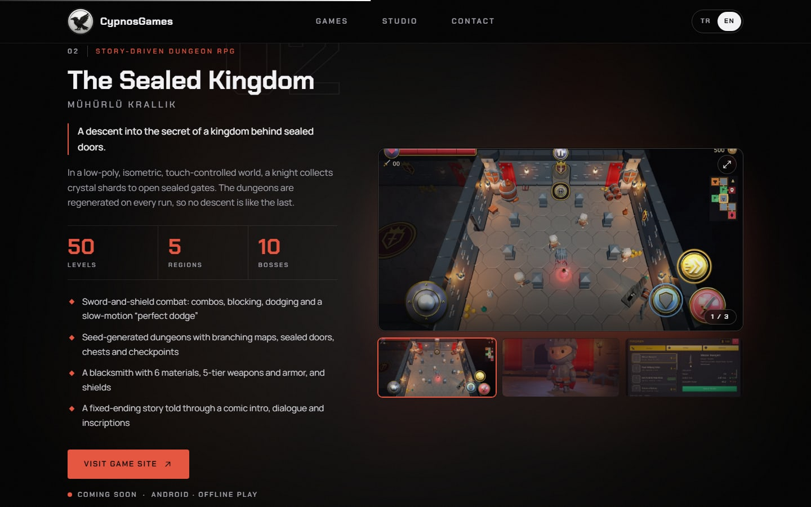
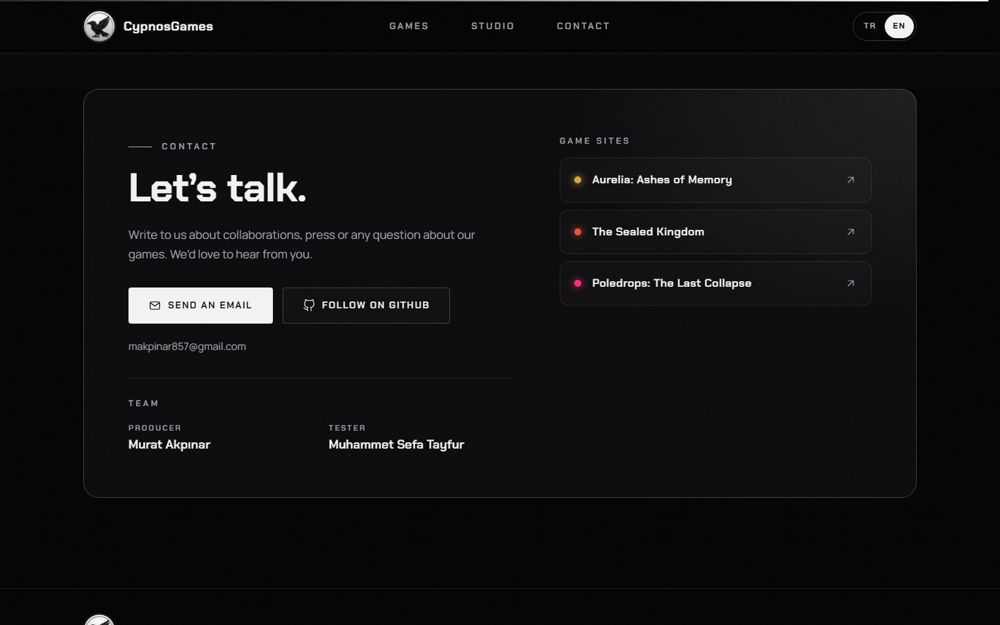
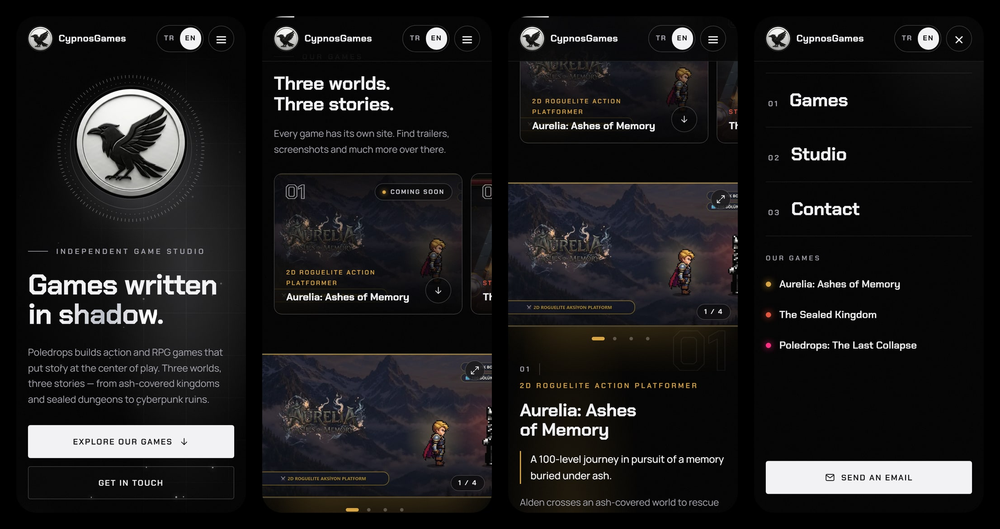

<div align="center">



# CypnosGames — Game Studio Website

**A cinematic, mobile-first, bilingual (TR / EN) website for an independent game studio — built with React and Vite.**

[](https://poledrops.github.io/oyunlarsitesi/)
[](https://github.com/Poledrops/oyunlarsitesi/actions/workflows/deploy.yml)


**[→ Visit the live website](https://poledrops.github.io/oyunlarsitesi/)**

</div>

---

## Table of contents

- [About the project](#about-the-project)
- [Features](#features)
- [Screenshots](#screenshots)
- [Tech stack](#tech-stack)
- [Getting started](#getting-started)
- [Project structure](#project-structure)
- [Customization](#customization)
- [Deployment](#deployment)
- [Games showcased](#games-showcased)
- [Team & developer information](#team--developer-information)
- [License](#license)

## About the project

This repository contains the official studio website that presents the Poledrops games to players, press and
collaborators. It acts as a single hub that introduces the studio and links out to the dedicated website of every game:

| Game | Genre | Site |
| --- | --- | --- |
| **Aurelia: Ashes of Memory** | 2D roguelite action platformer | [poledrops.github.io/AureliaSite](https://poledrops.github.io/AureliaSite/) |
| **The Sealed Kingdom** (Mühürlü Krallık) | Story-driven dungeon RPG | [poledrops.github.io/SealedKingdomSite](https://poledrops.github.io/SealedKingdomSite/) |
| **Poledrops: The Last Collapse** | Cyberpunk platformer & hack-and-slash | [poledrops.github.io/Poledrops_The_Last_CollapseSite](https://poledrops.github.io/Poledrops_The_Last_CollapseSite/) |

The design language is deliberately minimal: a pure black canvas, the silver raven emblem, and one accent colour per game
(gold for Aurelia, crimson for The Sealed Kingdom, magenta for The Last Collapse).

## Features

**Design & experience**
- Pure black, cinematic visual identity built around the raven emblem, with a fine film-grain texture
- Animated hero with a watch-bezel emblem, floating embers, count-up statistics and a pointer-driven spotlight (mouse devices)
- Per-game showcase sections with their own accent colour, key facts, feature lists and release status
- Poster-style game index — a grid on desktop, a swipeable rail on phones
- Image gallery per game: scroll-snap carousel (touch swipe, trackpad, arrows, thumbnails, dots) plus a full-screen lightbox
  with keyboard, swipe and swipe-down-to-close support
- Scroll-reveal animations, reading-progress bar and an ambient blurred backdrop on large screens

**Mobile first**
- Fluid layout verified from 320 px phones through tablets to large desktops, with no horizontal overflow
- Full-screen mobile navigation with quick links to every game
- Thumb-friendly 44 px+ touch targets, hover effects limited to devices that actually hover
- Safe-area support for notched phones (`viewport-fit=cover`)
- Heavy visual effects (blurred backdrops) are disabled on small screens to keep scrolling smooth

**Content & internationalisation**
- Turkish and English, switchable at runtime; the language is detected from the browser and remembered
- All copy lives in plain data files — no code changes are needed to edit text, games or credits
- Editable brand text next to the logo (single constant)

**Quality**
- Accessible by design: semantic landmarks, skip link, keyboard-operable gallery and menu, focus management in the
  lightbox, visible focus rings, `prefers-reduced-motion` support
- Optimised assets (WebP, lazy loading, async decoding) and a ~80 kB (gzip) JavaScript bundle
- SEO and sharing metadata: canonical URL, Open Graph / Twitter card, web app manifest, `robots.txt`
- Automated build and deployment to GitHub Pages on every push to `main`

## Screenshots

<table>
  <tr>
    <td width="50%"><br /><sub><b>Hero</b> — emblem, headline and live statistics</sub></td>
    <td width="50%"><br /><sub><b>Game index</b> — poster cards with release status</sub></td>
  </tr>
  <tr>
    <td width="50%"><br /><sub><b>Game showcase</b> — gallery, facts and features</sub></td>
    <td width="50%"><br /><sub><b>Contact</b> — details, team credits and game sites</sub></td>
  </tr>
</table>

**Mobile** — hero, swipeable game index, gallery carousel and the full-screen menu:



## Tech stack

| Area | Technology |
| --- | --- |
| UI library | [React 19](https://react.dev) (hooks, portals, context) |
| Build tool | [Vite 8](https://vite.dev) with `@vitejs/plugin-react` |
| Styling | Hand-written modern CSS (custom properties, grid, `clamp()`, scroll-snap, `env(safe-area-inset-*)`) |
| Typography | [Chakra Petch](https://fonts.google.com/specimen/Chakra+Petch) and [Manrope](https://fonts.google.com/specimen/Manrope) via Google Fonts |
| Icons | Inline SVG (no icon library) |
| Hosting & CI/CD | GitHub Pages deployed with GitHub Actions |

There are no runtime dependencies beyond React and React DOM.

## Getting started

### Prerequisites

- [Node.js](https://nodejs.org) **20.19 or newer** (22 LTS or later recommended)
- npm (bundled with Node.js)

### Installation

```bash
# 1. Clone the repository
git clone https://github.com/Poledrops/oyunlarsitesi.git
cd oyunlarsitesi

# 2. Install dependencies
npm install

# 3. Start the development server  →  http://localhost:5173
npm run dev
```

### Available scripts

| Command | Description |
| --- | --- |
| `npm run dev` | Start the Vite development server with hot reloading |
| `npm run build` | Create an optimised production build in `dist/` |
| `npm run preview` | Serve the production build locally (default `http://localhost:4173`) |

## Project structure

```text
.
├── .github/workflows/deploy.yml   # Build + deploy to GitHub Pages
├── assets/logo.webp               # Original brand image (source of the generated icons)
├── docs/screenshots/              # Images used in this README
├── public/                        # Static files copied as-is to the build
│   ├── games/<game>/              # Artwork for each game (WebP)
│   ├── logo-mark.webp|png         # Cropped raven emblem
│   ├── favicon.png, apple-touch-icon.png, icon-192.png
│   ├── og.jpg                     # Social sharing preview
│   ├── manifest.webmanifest
│   └── robots.txt
├── src/
│   ├── components/                # Header, Hero, GameRail, GameShowcase, Gallery, Lightbox,
│   │                              # Studio, Contact, Footer, Brand, ScrollProgress, Reveal, CountUp, …
│   ├── data/
│   │   ├── site.js                # Studio name, brand text, e-mail, GitHub link, year
│   │   ├── content.js             # All UI copy (TR / EN) and team credits
│   │   └── games.js               # Games: texts, stats, links, status, gallery
│   ├── styles/                    # base, header, hero, games, studio, contact
│   ├── App.jsx
│   ├── i18n.jsx                   # Language provider (TR / EN)
│   └── main.jsx
├── index.html                     # Entry point + SEO / social metadata
├── vite.config.js                 # base: './' → works from any sub-path
└── package.json
```

## Customization

| I want to… | Edit |
| --- | --- |
| Change the **brand name** (text next to the logo, browser-tab title, footer copyright) | `STUDIO.brandText` in [`src/data/site.js`](src/data/site.js) — use `''` to show only the logo and fall back to the studio name. Also update the static copies in [`index.html`](index.html) (`<title>`, `og:title`, `og:site_name`) and [`public/manifest.webmanifest`](public/manifest.webmanifest), which crawlers read without running JavaScript |
| Change the studio name, contact e-mail, GitHub link or copyright year | [`src/data/site.js`](src/data/site.js) |
| Edit **team credits** (producer, tester, …) | `contact.team` in [`src/data/content.js`](src/data/content.js) |
| Edit headings and other copy in Turkish / English | [`src/data/content.js`](src/data/content.js) |
| Update a game (description, stats, links, release status, gallery) | [`src/data/games.js`](src/data/games.js) |
| **Add a new game** | Copy an entry in the `games` array in [`src/data/games.js`](src/data/games.js) and drop its images into `public/games/<id>/` — the index, showcase, contact list and statistics update automatically |
| Change colours, fonts or spacing | CSS variables in the `:root` block of [`src/styles/base.css`](src/styles/base.css) |

Every text field is a `{ tr: '…', en: '…' }` pair, so both languages stay in sync.

## Deployment

The site is published to **GitHub Pages** by [`.github/workflows/deploy.yml`](.github/workflows/deploy.yml):
every push to `main` installs dependencies with `npm ci`, builds the site and deploys the `dist/` folder.

Live URL: **https://poledrops.github.io/oyunlarsitesi/**

Because `vite.config.js` uses `base: './'`, the build also works from any other host or sub-path:

```bash
npm run build      # then upload the contents of dist/ to any static host
```

## Games showcased

All three games are by Poledrops and are currently marked as **coming soon** on the site:

- **Aurelia: Ashes of Memory** — 100 levels, 10 acts, 10 bosses; elemental spells, a weapon forge, secret rooms and an endless mode.
- **The Sealed Kingdom** — low-poly isometric dungeon RPG with seed-generated dungeons, a 5-tier crafting system, 5 regions and 10 bosses.
- **Poledrops: The Last Collapse** — cyberpunk revenge story told through 41 cinematic records across 10 chapters and 10 bosses.

## Team & developer information

| Role | Name |
| --- | --- |
| Producer | Murat Akpınar |
| Tester | Muhammet Sefa Tayfur |

Developed and maintained by **Poledrops** — [github.com/Poledrops](https://github.com/Poledrops).
Questions, collaborations and press enquiries: see the *Contact* section of the [live website](https://poledrops.github.io/oyunlarsitesi/#contact).

## License

Copyright © 2026 Poledrops. All rights reserved.
The game artwork, names, logo and emblem shown in this project are the property of Poledrops and may not be reused without permission.
